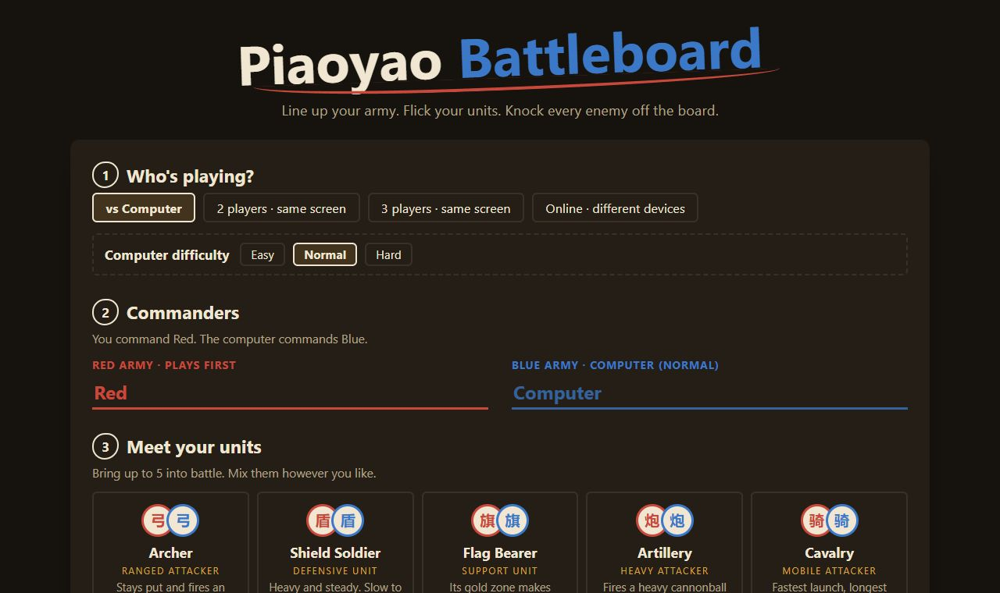
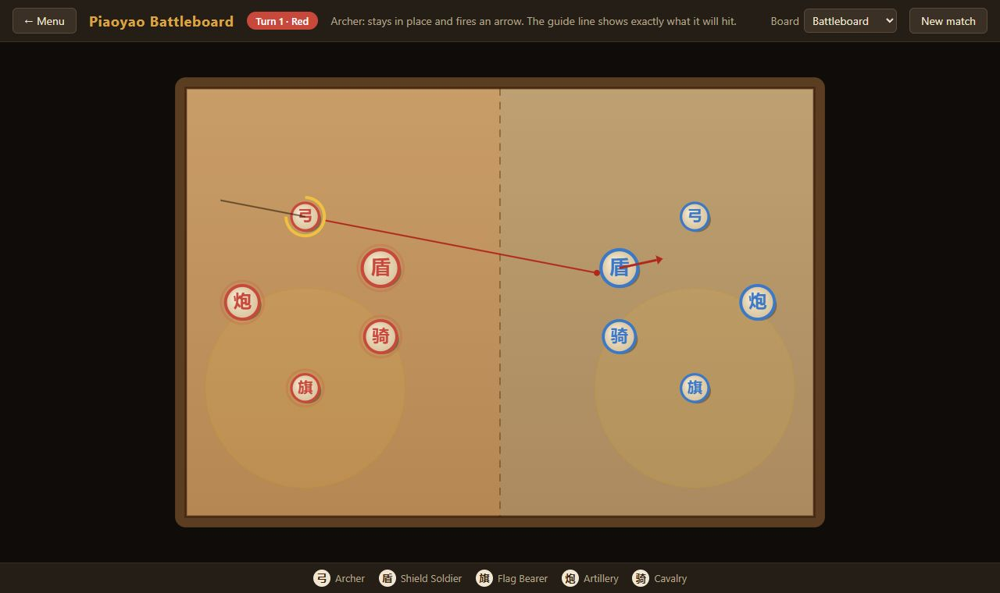
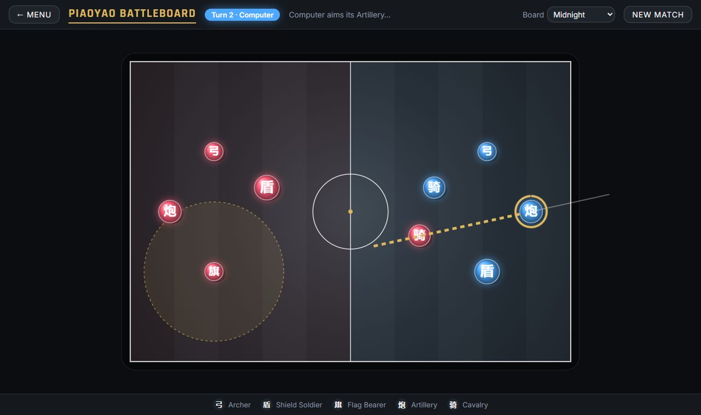
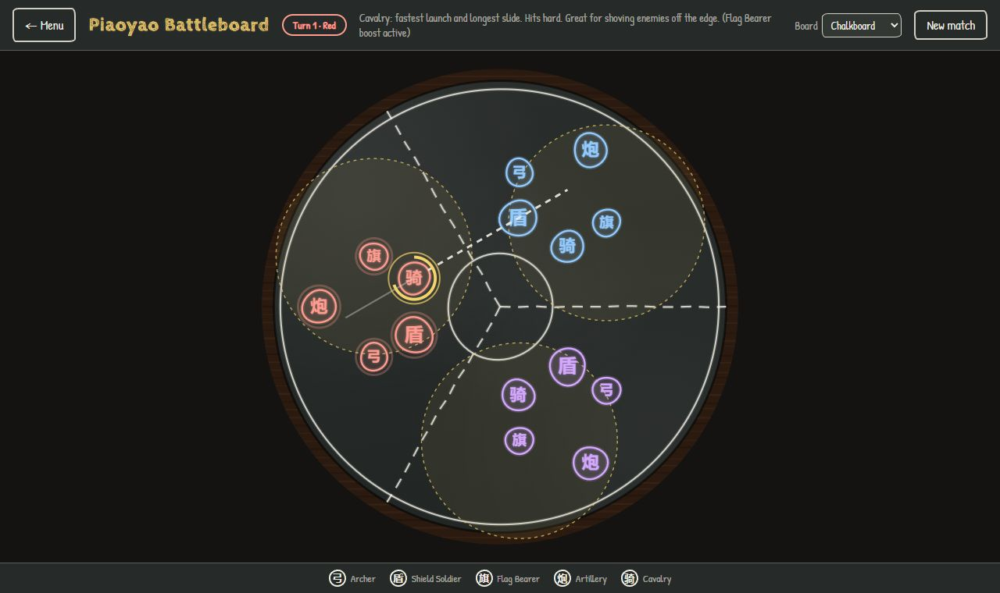
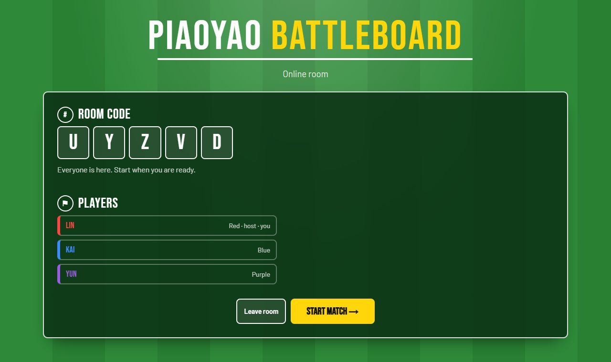
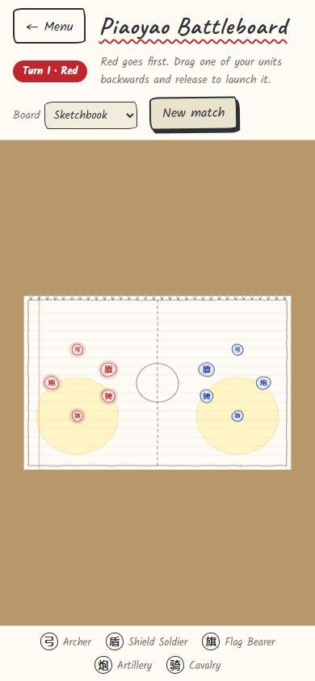
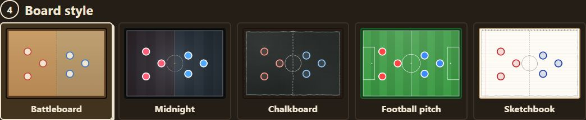

The following game is a Piao game inspired web game
that can be played online on GitHub Pages.

## Web version

**Play online (main version):** https://drag375o.github.io/PiaoYao_Tabletop_game/

This GitHub Pages site is the **main version** of the game. It is served straight from the `main` branch and updates on every push, so it always has the latest features (vs Computer, 3 players, online rooms). All development continues here.

**Older Netlify copy:** https://piaoyao-battleboard.netlify.app is kept as-is. It is an earlier snapshot (start page and 2 players on one screen) and is no longer updated. `netlify.toml` belongs to it.

### Screenshots

| Start page | Two players: the Archer's guide line shows exactly what it will hit |
|---|---|
|  |  |
| **vs Computer** (Midnight theme): the computer lines up its shot | **3 players** on the round arena (Chalkboard theme) |
|  |  |
| **Online room** for 3 players (Football pitch theme) | **On a phone** (Sketchbook theme) |
|  |  |

**Board styles** (chosen on the start page or from the in-game Board menu):

A static HTML/canvas site with no build step, so it can be served as-is. GitHub Pages serves the repo root (`.nojekyll` turns off Jekyll processing).

**Run locally:** from the project folder run `python -m http.server 8000` and open http://localhost:8000.

**Start page:** the game opens on a start page in the Auction XI style. It has sections for who's playing (vs Computer, 2 or 3 players on one screen, or Online), the commanders' names (remembered in this browser), the five units, board style cards with live previews, and how to play. **To the battlefield** starts a match. **← Menu** in the game returns to the start page, which then offers **Resume match**.

**Board themes:** pick one from the **Board** menu in the top bar. Your choice is remembered in this browser. The styles come from the Auction XI project's themes:
- **Battleboard** (default): warm wood and sand with cream game discs.
- **Midnight**: charcoal tactics board in a black bezel, with gold accents and metallic tokens.
- **Chalkboard**: slate in a walnut frame, with chalk lines and chalk-drawn units.
- **Football pitch**: mown grass and white markings, with kit-coloured discs.
- **Sketchbook**: ruled notebook paper with spiral binding, and units circled in pen.

**Controls:** press on a piece, drag backwards (like a slingshot) and release. A longer pull gives more force (the yellow ring shows power). A very short pull cancels the launch.

**Game modes:**
- **vs Computer:** you command Red, and the computer commands Blue. It picks its own army and formation. On its turn it tries every unit against every enemy at several angles and strengths, plays each shot out with the real physics, and launches one of the best. **Easy** picks loosely and aims roughly, **Normal** is a fair fight, and **Hard** almost never misses.
- **2 players · same screen:** hot-seat. Red plays the left half, Blue the right.
- **3 players · same screen:** hot-seat for Red, Blue and Purple on a **round arena** split into three equal 120° wedges, one per army. The rules are the same: set up in your own wedge, take turns (Red → Blue → Purple; armies that have been wiped out are skipped), and knock units off the round edge. The last army standing wins.
- **Online · different devices (2 or 3 players):** one player picks **Create a room**, chooses 2 or 3 players, and shares the 5-letter room code. The others open the game on their own phone or computer, choose **Online**, type the code and press **Join room**. Once at least one friend has joined, the host presses **Start match**. The computer fills any empty seat. The host plays Red, and guests play Blue (and Purple), each on their own device with their own board theme. A 3-player room uses the round arena.
  - **How it works:** peer-to-peer over WebRTC using [PeerJS](https://peerjs.com), the same approach as Auction XI, so no server of our own is needed. The free PeerJS server only introduces the browsers to each other. The host's browser runs the real game and physics. Guests send their moves (army choice, unit placement, Ready, aiming, launches), the host checks them against the rules, and the board is streamed back about 20 times a second. Everyone sees each other aim.
  - **If someone leaves:** if a guest disconnects mid-match, the computer takes over their army so the match can finish. If the host leaves, the guests are told and returned to the start page.

**How a match runs:**
- **Choose your army:** each player picks up to 5 units, and repeats are allowed (e.g. 3 Cavalry + 2 Shield Soldiers). **One of each** fills the default army.
- **Set your formation:** the chosen units appear in a default formation in your zone (your half, or your wedge in a 3-player game). Drag them anywhere inside your zone (they can't overlap), then press **Ready**. Armies set up in turn order.
- Red goes first in battle. On your turn you launch one of your own units (they pulse in your colour). The turn passes once every piece has stopped.
- Pieces slide with friction and collide with momentum-based knockback, including chain collisions.
- A piece is eliminated when its centre crosses the board edge.
- The match ends when only one army has units left, and that army wins. If the last armies are all wiped out on the same turn, it's a draw. **New match** restarts at any time.

**Units in this web version** (stats are this version's own tuning, not official numbers):

| Glyph | Unit | How it plays here |
|---|---|---|
| 弓 | Archer | Stays in place and fires an arrow. The arrow disappears after its first hit. Its trajectory indicator shows the exact unit the arrow will strike and the direction that unit will be knocked. |
| 盾 | Shield Soldier | Heaviest unit with high friction and soft impacts. Slow to launch but very hard to push away. |
| 旗 | Flag Bearer | Has a gold speed zone. Allies whose centre is inside it launch (or fire) 30% faster. |
| 炮 | Artillery | Fires a heavy cannonball that keeps rolling through clustered units. The artillery recoils slightly backwards. |
| 骑 | Cavalry | Fastest launch and longest slide, with a heavy impact. Built for shoving enemies off the edge. |

**Code layout** (plain JavaScript, no build step):

| File | What it does |
|---|---|
| `index.html` | Start page, online lobby and game screen |
| `css/style.css`, `css/home.css` | Layout shared by every theme |
| `css/themes/*.css` | One stylesheet per board theme |
| `js/units.js` | Unit and projectile stats |
| `js/physics.js` | Disc physics: friction, collisions, falling off the edge |
| `js/arena.js` | Board shapes: rectangle (2 armies) and round arena (3 armies) |
| `js/rules.js` | Launching, Flag Bearer boost, arrow hits, Archer aim preview |
| `js/ai.js` | Computer player |
| `js/themes.js` | Canvas drawing for each board theme |
| `js/game.js` | Match flow, input and rendering, plus the online host/guest hooks |
| `js/home.js` | Start page |
| `js/net.js`, `js/online.js` | Online rooms (PeerJS) and the lobby |

The game instruction are as follows :
# Piaoyao Battleboard
### Where Winds Meet – Game Rules & Mechanics

## 1. Game Overview

Piaoyao Battleboard is a two-player, physics-based tactical board game featured in *Where Winds Meet*.

Players command miniature military units on a battlefield. The objective is to eliminate the opponent's units by launching pieces into them and knocking them outside the battlefield.

The game combines:
- Tactical unit positioning.
- Formation planning.
- Physics-based movement.
- Collision and knockback mechanics.
- Different military unit abilities.

**Basic Information**
- Players: 2
- Game Type: Turn-based tactical physics game
- Battlefield: Miniature arena
- Team Size: Up to 5 units per player
- Turn System: Alternating turns
- Main Objective: Eliminate all opposing units
- Victory Condition: Be the last player with surviving units.

## 2. Game Setup

### Unit Selection

Each player selects up to five available military units.

The available unit types are:

1. Archer
2. Shield Soldier
3. Flag Bearer
4. Artillery
5. Cavalry

Players can create different combinations depending on their available units.

### Formation Setup

1. Each player receives their own side of the battlefield.
2. Players arrange their selected units in their starting area.
3. Both players complete their formations.
4. The match begins.

Unit positioning is important because exposed pieces can be eliminated early.

## 3. Unit Types and Abilities

### 3.1 Archer

**Role:** Ranged attacker

- Uses a trajectory indicator to help aim.
- Can attack opposing units from a distance.
- Useful for targeting exposed enemy pieces.
- Requires accurate aiming.

### 3.2 Shield Soldier

**Role:** Defensive unit

- Designed for stability and defensive positioning.
- Useful for holding important positions.
- Can help protect other units.
- Better suited to defensive formations.

### 3.3 Flag Bearer

**Role:** Support unit

- Creates a speed-enhancing zone.
- Improves the movement capabilities of nearby allied units.
- Supports coordinated attacks.
- Most effective when positioned near other units.

### 3.4 Artillery

**Role:** Heavy attacker

- Launches towards opposing units.
- Uses a cannonball as part of its attack.
- Can disrupt enemy formations.
- Useful against clustered opposing units.

### 3.5 Cavalry

**Role:** Mobile attacker

- Designed for fast movement.
- Delivers powerful physical impacts.
- Useful for pushing enemy units towards the battlefield edges.
- Best suited to aggressive attacks.

## 4. Turn System

Players take turns performing attacks.

Each turn follows this general sequence:

1. Select one available unit.
2. Choose the direction of attack.
3. Aim using the available trajectory indicator.
4. Launch the selected unit.
5. Resolve collisions and movement.
6. Check whether any units have fallen outside the battlefield.
7. End the turn and allow the opponent to play.

Only surviving units remain available for subsequent turns.

## 5. Movement and Launch Mechanics

Piaoyao uses physics-based movement rather than traditional grid-based movement.

### Launching

- Players aim their selected units.
- The direction and force of the launch influence movement.
- Units move across the battlefield.
- A moving unit can collide with stationary or other moving units.

### Collision

When units collide:

- The impacted unit can be pushed backwards.
- The direction of the collision affects its movement.
- Momentum influences the resulting knockback.
- Units can potentially collide with multiple pieces.

### Elimination

A unit is eliminated when it moves outside the battlefield boundaries.

There is no conventional health-bar or damage-based elimination system in the basic gameplay description.

## 6. Battlefield Positioning

Positioning is one of the most important parts of the game.

Players should consider:

- Distance from the battlefield edges.
- Distance between friendly units.
- Enemy positioning.
- Potential collision directions.
- Opportunities for chain collisions.

Keeping units near the centre generally reduces the risk of accidental elimination.

## 7. Combat Strategy

### Offensive Strategy

- Use Cavalry to push opponents towards the edges.
- Use Archers for controlled attacks.
- Use Artillery to disrupt enemy formations.
- Target isolated enemy units.

### Defensive Strategy

- Keep important units away from the edges.
- Use Shield Soldiers in defensive positions.
- Keep Flag Bearers near allied units.
- Avoid exposing several units to one attack.

### Formation Strategy

- Avoid clustering all units together.
- Maintain enough space between units.
- Protect support units.
- Position offensive units where they can attack effectively.

## 8. Winning Conditions

A player wins when all opposing units have been eliminated.

**Victory Condition:**
- At least one friendly unit must remain on the battlefield.
- All opposing units must be outside the battlefield.

The match ends when one player has no surviving units.

## 9. Match Progression

Piaoyao also includes progression through NPC challenges.

Players can:
- Challenge NPC opponents.
- Win matches.
- Obtain additional units and rewards.
- Unlock further opponents.
- Expand their available unit collection.

The available units and opponent progression depend on in-game progression.

## 10. Rewards

Possible rewards from Piaoyao activities include:

- Echo Jade.
- Coins.
- Experience.
- Adventurer Slips.
- Achievement progress.

The achievement **Battleboard Beginner** is associated with completing a Piaoyao Battleboard game in Hexi.

## 11. Complete Gameplay Loop

1. Select up to five available units.
2. Arrange the starting formation.
3. Begin the match.
4. Select one unit during your turn.
5. Aim and launch.
6. Resolve collisions and knockback.
7. Eliminate units that leave the battlefield.
8. Alternate turns.
9. Continue until one player has no surviving units.
10. Award victory to the remaining player.

## 12. Important Gameplay Characteristics

| Feature | Description |
|---|---|
| Players | 2 |
| Unit types | 5 |
| Team size | Up to 5 |
| Movement | Physics-based |
| Combat | Collision and knockback |
| Elimination | Leaving battlefield |
| Turn system | Alternating |
| Strategy | Positioning and unit selection |
| Victory | Eliminate opposing units |

## 13. Reference and Verification Notes

This document describes the general gameplay and unit roles of Piaoyao Battleboard in Where Winds Meet.

Some exact mechanical details, including numerical unit statistics, launch-force values, collision calculations, setup restrictions and individual ability parameters, require in-game verification.

Do not assume that every unit has identical movement or collision properties.

### Reference Links

- Where Winds Meet – Piaoyao Battleboard gameplay guides.
- Digital Phablet – Piaoyao Battleboard guide.
- XboxPlay – Piaoyao unit and gameplay guide.

---

**End of README**